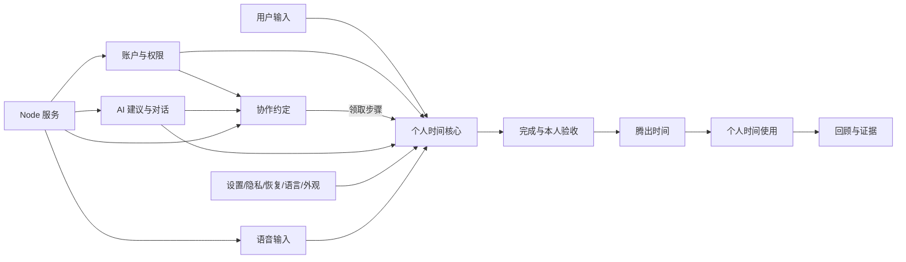

# Done&Go 当前产品核心能力与模块报告

**日期：** 2026-10-24（Asia/Shanghai）  
**范围：** 当前生产产品与当前仓库实现  
**当前入口：** `web/index.html` + `scripts/serve-tango.mjs`  
**核心架构基线：** `docs/DONEGO-CANONICAL-ARCHITECTURE-2026-10-16.md`

## 结论

Done&Go 当前真正的产品核心，是一条本地优先的时间闭环：

> **记录 → 完成 → 归还 → 使用**

用户先把一句话或一段语音变成可修改的事项，再安排时间、记录实际用时、确认结果，最后决定腾出的时间去向。系统只把本人确认过的结果纳入时间收益口径，估算、待确认、失败和未完成记录不会被包装成收益。

当前产品有两条主要价值链：

1. **个人时间链**：今天记录、时间路线、时间树、完成记录、回顾和个人时间使用。
2. **协作约定链**：多人约定、步骤、成员权限、版本确认、协作 AI 提案，以及把协作步骤领取回个人时间线。

账户、设置、语音、AI、语言和外观是支撑这两条链的能力。管理员控制台和发布服务是运营模块。它们决定产品能否安全运行，但不应与核心用户价值混成同一层。

当前最强的部分是个人时间模型、诚实的完成与收益记录、本地数据恢复机制，以及服务端协作状态机。当前最明显的产品边界是：个人核心记录仍以浏览器为权威，没有跨设备同步；真实邮件收件、真实模型供应商、数据库恢复和完整公开生产体验仍未完成验收。

## 当前产品边界

当前产品只有一个应用入口和七个路由：

| 路由 | 当前职责 | 所属能力链 |
|---|---|---|
| `#today` | 输入事项、查看事项池、调优先级、看今日预算、完成事项、选择腾出时间的去向 | 个人时间链 |
| `#line` | 按日期查看时间路线和时间树，打开事项详情与相关资讯 | 个人时间链 |
| `#review` | 回看已完成、已验收、实际用时、腾出时间和个人时间使用 | 个人时间链 |
| `#agreements` | 约定、小组、步骤、成员、邀请、确认、AI 提案和个人领取 | 协作约定链 |
| `#settings` | 账号安全、本地偏好、AI 同意、导入导出、备份恢复、语言与外观等 | 支撑模块 |
| `#assistant` | 对话、优先级建议、模型建议、回顾反思、资讯发现 | AI 支撑模块 |
| `#users` | 管理员查看账号、统计、启停或删除用户、修改全局模型配置 | 运营模块 |

`src/` 下的 React/Vite 线路、`server/start.mjs`、旧 `/inbox` 资料和早期双人协商实现都明确标注为历史或研究资料。设计目录中的 18 屏 PRD 是设计与规划参考，不能直接当作当前产品已经提供的 18 个页面或能力。

当前还有一层只给开发测试开启的界面。`window.__TANGO_DEVELOPER_UI__` 由测试显式注入，普通产品不会从 URL 或 localStorage 打开它。详细成本拆分、学习护栏、模型评测导出、cohort 导出和部分诊断入口属于这层，不能直接当成普通用户的公开承诺。

## 模块地图

### 1. 个人时间核心

**用户能力**

- 用文字输入一句事项，例如“14:00–15:00 开会”。
- 通过规则解析识别日期、时间、时长、优先级和事项类别。
- 使用六种时间类别：必要、恢复、创造、连接、探索、自己的时间。
- 在今天页面调整事项、优先级和时间区间。
- 通过事项池、气泡区域、今日路线和时间预算理解当前安排。
- 处理重叠时间，避免把重叠区间简单相加。

**实现模块**

- 主要实现集中在 `web/index.html` 的 `TangoTime` 内联模块。
- 规则解析、时间区间、事项状态、类别和优先级都在同一个当前页面实现中。
- `web/privacy.js` 负责状态清洗与结构校验。
- `web/collaboration-personal.js` 负责把协作步骤转成当前账号的个人事项。

**数据**

- 个人事项、草稿、完成记录、方法和偏好保存在浏览器 `localStorage`。
- 当前主键是 `tango-donego.web.v1`，账户包装层会为真实账号生成隔离键。
- 浏览器是个人时间数据的权威来源，服务端不保存普通个人事项正文。

**判断**

这是最核心、最有辨识度的模块。它不是普通待办列表，因为它同时记录责任、时间区间、实际用时和之后的个人时间去向。当前的主要结构风险是：核心领域逻辑仍大量内联在 `web/index.html`，路由渲染、状态存储、AI 入口和交互事件高度靠近。后续新增时间规则时，应继续维护一个稳定的时间核心接口，避免把同一规则复制到页面、AI 和协作适配器中。

### 2. 完成、本人验收与时间归还

**用户能力**

- 标记事项完成。
- 记录实际用时，也可以先完成后补记用时。
- 记录是否使用 AI，以及可选的模型名称。
- 在开发测试界面记录准备、执行、核对、返工和额外操作成本；普通用户界面保持较轻的完成表单。
- 只有经过本人验收、结果可用且实际用时有效的记录，才进入腾出时间计算。
- 腾出的时间先进入待处理状态，用户可以选择散步、自由安排或另选时段。
- 事后再记录这段时间是否真正被保住、部分使用或被占用。

**实现模块**

- `completeTask`、`recordCompletion`、`reviseCompletion` 和 `Time.confirmedSavings` 位于 `web/index.html`。
- `freed.pending` 表示腾出时间尚未决定去向。
- `reserveFreed`、`useTime` 和静驻相关状态记录预留与实际使用的差异。
- `web/privacy.js` 校验 completion、trial、costs、learning 和模型证据字段。

**产品规则**

- 计划时长减实际用时只是观察结果，不是 AI 的因果收益证明。
- 估算值、个人自述和已验收结果必须分开。
- 没有实际用时、没有本人验收或结果需要返工时，不应进入确认收益。
- 没有用途的时间可以保持空白，不需要被系统重新填满。

**判断**

这是产品可信度的核心。Done&Go 的差异不在于“给出一个省时数字”，而在于把计划、实际、核验、返工成本和时间去向分别记账。任何后续迭代都不能把这几种状态合并成一个完成布尔值。

### 3. 时间路线、时间树与回顾

**用户能力**

- `#today` 看当前时段和下一站。
- `#line` 按日期浏览事项和时间树。
- 时间树用芽、花、果实表达计划、经过和完成状态。
- `#review` 查看 7 天或 30 天范围内的完成、实际用时、已验收结果、个人时间使用和方法复用。
- 查看某条事项的事件记录、模型建议和协作来源。

**实现模块**

- `treeSvg`、`treeStage`、`pageLine` 和 `leafSheet` 在 `web/index.html`。
- `pageReview`、`userReview`、`personalUseDetails` 和 `modelEvaluationRows` 负责回顾投影。
- `refreshTree` 每 30 秒刷新时间树，不覆盖用户当前输入或打开的弹层。

**判断**

这三个路由应被视为一个连续模块，而不是三个独立页面：今天产生事实，时间树提供空间化回看，回顾把事实转成下一次选择。当前回顾中的跨用户 cohort、留存和因果效果明确为空或未知，不能把本机单浏览器汇总说成产品效果。

### 4. AI 建议、伴聊与资讯发现

**用户能力**

- 对一句输入做 AI 整理，生成可编辑的事项草稿。
- 请求优先级、模型建议或回顾反思。
- 与“和探戈聊聊”进行对话。
- 查看国内模型能力卡、适用范围、官方链接和个人历史参考。
- 按主题发现研究、工作和学习资讯。
- 为事项生成可复制的专属提示词。

**实现模块**

- `web/assistant-ui.js` 管理对话界面、共享上下文和流式回复。
- `web/assistant-core.js` 负责会话清洗、建议和隐私状态。
- `web/ai-parse.js` 负责解析结果的提取、日期限制、规则结果与 AI 结果的差异合并。
- `scripts/ai-assistant.mjs` 是服务端模型网关，提供 heavy、standard、light 三档、超时、并发、响应大小和输出清洗。
- `scripts/ai-discovery.mjs` 聚合四个资讯源，使用 45 天窗口和 15 分钟缓存。
- `web/model-catalog-cn.js` 是能力卡，不是模型接入证明。

**接口**

- `POST /api/assistant/chat`：普通回复或 `text/event-stream` 流式回复。
- `GET /api/assistant/config`：读取服务端模型配置。
- `PUT /api/assistant/config`：仅管理员可以修改。
- `GET /api/assistant/features`：读取解析与提示词功能开关。
- `GET /api/discovery?topic=`：读取资讯发现。

**产品边界**

- AI 只能给建议、草稿和差异，不能直接改写时间账本。
- 事项建议需要用户手动采纳，旧建议不能覆盖新状态。
- 发送到外部模型前应显示处理端点、模型和共享上下文预览。
- 用户消息、事项正文和外部资讯都被视为不可信数据，不能改变系统指令。
- 模型不可用时，规则解析和手写输入仍应可用。

**判断**

AI 是一个适配器，不是领域权威。当前 AI 工程护栏比较完整，真正未闭环的是外部 provider 的实际可用性、额度和任务级效果。模型卡、fixture 回复和单元测试不能替代真实供应商验收。

### 5. 约定与小组协作

**用户能力**

- 创建共同目标、内容、交付物、期限和材料。
- 添加步骤、负责人、复核人、参与人、依赖和完成标准。
- 邀请普通成员或只读成员加入。
- 通过 `todo → active → review → done` 推进步骤，也可以标记受阻。
- 对重要变更要求理由，并使相关确认失效后重新确认。
- 查看历史、审计、来源和版本。
- 按字段选择是否允许 AI 使用共同目标、步骤、成员、结果和材料。
- 把一个协作步骤领取到自己的个人时间线。

**实现模块**

- `web/collaboration-ui.js`：协作界面、表单、角色操作、提案编辑和个人领取。
- `web/collaboration-personal.js`：协作步骤与个人浏览器时间记录之间的桥接。
- `scripts/collaboration-service.mjs`：认证、路由、AI 提案校验和限流。
- `scripts/collaboration-store.mjs`：服务端状态机、SQLite 持久化、权限、修订、确认和审计。
- `web/collaboration-copy.js`：协作模块的六语文案。

**数据与权限**

- `owner` 可以管理小组和成员。
- `member` 可以在授权范围内写入。
- `viewer` 只读，不能写步骤、结果或提案。
- `revision` 用于乐观并发控制。
- 关键分工、期限、材料和共享范围变化会提升 `termsVersion` 或 `policyVersion`。
- 邀请只保存摘要，具备有效期和撤销机制。
- SQLite 使用 WAL，保存小组、审计、邀请、个人领取和 AI 提案。

**判断**

协作模块是当前最清晰的深模块之一：浏览器只负责交互，服务端负责权限、状态和审计。它的价值不在“多人同时编辑”，而在于把共同约定、个人责任和确认状态分开保存，再把已授权的协作步骤接回个人时间链。真实双账号、服务重启、备份恢复和公开环境仍需单独验收。

### 6. 账户认证与管理员模块

**用户能力**

- 邮箱验证码注册、密码登录、退出和找回密码。
- 支持邮箱或手机号作为账号输入。
- 保存称呼、修改密码、查看验证状态。
- 普通用户和管理员分离。
- 管理员查看账号统计、账号列表，启用、停用或删除账号，并修改全局模型配置。

**实现模块**

- `web/app-auth.js`：登录墙、注册、验证、登录、演示入口和六语文案。
- `web/users-admin.js`：管理员用户表和账号操作。
- `server/auth/service.mjs`：JWT 会话、scrypt 密码哈希、验证码、会话失效和认证事件。
- `server/auth/email.mjs`：Resend、SMTP 和 console 传输适配器及品牌化邮件。
- `server/auth/config.mjs`：HTTPS origin、密钥长度、生产传输和安全 Cookie 约束。

**判断**

代码侧的认证模块已经形成独立服务接口，能为个人数据和协作身份提供共同身份根。当前最大的证据缺口是外部真实邮箱收件和用户本人完整注册体验；fixture 邮箱只能证明状态机。生产管理员流程和删除账号后的协作资源清理也应保持独立验收。

### 7. 设置、隐私、恢复、语言与外观

**用户能力**

- 设置称呼、清醒时长、提示音和 AI 整理同意。
- 导出、导入、载入示例、清空和从最近备份恢复。
- 主存损坏时保护原始内容，允许导出或从有效备份恢复。
- 标签页发生并发修改时，阻止旧快照覆盖新快照。
- 六种语言，阿拉伯语 RTL。
- 五套外观，并支持亮暗方向和跨标签页同步。
- 诊断导出不包含姓名、事项正文、标识符或密钥。

**实现模块**

- `web/privacy.js`：状态校验、敏感字段清洗、端点安全检查和诊断导出。
- `web/appearance.js`、`web/appearance.css`：外观存储与同步。
- `web/locale-copy.js`、`web/collaboration-copy.js` 和认证/管理模块内部文案表：语言切换。
- `replaceWithSnapshot`、`restore-backup-yes` 和跨标签页 storage 监听：恢复与冲突处理。

**判断**

这是个人时间核心的保护层，不是可有可无的设置页。因为个人记录没有服务端副本，导入、导出、损坏保护、备份和冲突检测就是当前数据可靠性的主要边界。跨设备同步目前明确未启用，不能把账号登录描述成个人时间数据已经云同步。

### 8. 文字、语音与演示入口

**文字与语音**

- 文字输入始终是核心回退路径。
- `web/speech-capture.js` 负责录音、16 kHz WAV、静音停止和 30 秒上限。
- `scripts/tango-speech.mjs` 提供能力探测和转写；当前本机路径依赖 Windows `System.Speech`。
- `/api/speech/transcribe` 要求 `audio/wav`、来源校验、登录和大小限制。

**演示模式**

- `TANGO_DEMO_MODE=1` 使用内存会话和内存协作数据。
- 访客入口不需要真实邮箱和密码。
- 访客不能访问管理员接口或修改全局 AI 配置。
- 服务重启后演示会话和小组清空，不能代表正式 SQLite 数据会清空。

**判断**

语音降低记录门槛，但不是核心数据来源。非 Windows 环境和真实设备麦克风仍是环境性边界。演示模式是评审和回归工具，不应混入正式账号、真实邮件或生产持久化结论。

## 数据归属与系统接口

| 数据类别 | 权威位置 | 当前状态 |
|---|---|---|
| 个人事项、草稿、完成、试验、方法、个人时间使用 | 当前浏览器 `localStorage`，真实账号使用隔离键 | 本地优先；无跨设备同步 |
| 个人偏好、语言、外观、AI 同意 | 当前浏览器 `localStorage` | 账号或浏览器范围；外部密钥不应保存到前端 |
| 账号、会话、验证码、认证事件 | 服务端认证 SQLite | 服务端权威；真实邮件仍待验收 |
| 小组、成员、步骤、邀请、审计、确认、提案 | 服务端协作 SQLite | 服务端权威；使用 WAL |
| 协作步骤领取到个人时间线的副本 | 服务端 link + 当前账号浏览器个人记录 | 通过 `collaboration-personal.js` 关联；不是全局同步 |
| AI 对话和隐私偏好 | 当前浏览器隔离存储；模型配置在服务端 | 外部 provider 是否可用仍未知 |
| 演示会话和演示小组 | 内存 | 重启清空，不能当正式数据 |

这个数据分配解释了产品的当前形态：登录主要保证账号、协作和管理权限；它不会自动把个人时间账本变成服务端云数据。后续若要跨设备，需要单独定义个人记录的服务端权威、迁移、冲突和隐私边界，不能只在现有登录接口上叠加同步。

## 模块成熟度与证据边界

| 模块 | 代码实现 | 自动化入口 | 真实/生产证据 |
|---|---|---|---|
| 个人时间核心 | 当前实现明确 | `verify:web`、时间/隐私/方法测试、today/tree/review Playwright | 本轮未重跑；跨设备同步不存在 |
| 完成与收益口径 | 当前实现明确，开发与普通用户界面有差异 | completion/time-benefits/review 测试 | 真实用户长期效果未知 |
| AI 建议与伴聊 | 网关、护栏、回退和流式路径已实现 | AI 单测、assistant/assistant-boundaries、fixture E2E | 真实 provider、额度和任务效果未知 |
| 协作约定 | 服务端状态机和角色权限已实现 | 协作单测、`verify:collaboration` | 真实双账号、公开环境、恢复演练未知 |
| 账户认证 | 代码和 fixture 链路已实现 | auth 单测、`verify:account` | 真实邮箱收件和本人验收未知 |
| 设置与恢复 | 本地恢复、导入、损坏保护和冲突保护已实现 | release-readiness、privacy/save-state 测试 | 浏览器/设备组合与长期备份恢复仍需实测 |
| 语音 | Windows 本机路径已实现，文字可回退 | speech 单测、voice spec | 其他环境和真实设备能力未知 |
| 演示模式 | 独立内存路径已实现 | `verify:demo-direct` | 只能证明演示隔离，不证明正式生产 |
| 服务与安全外壳 | 单进程静态文件 + API + Host/Origin/认证保护 | release/preflight/HTTP 测试 | 数据库恢复、cloudflared 托管和公开运维未知 |

本报告没有重跑测试；上表的“自动化入口”表示仓库中存在相应测试或脚本，不表示本次报告已得到新的通过结果。上一轮只读运行时核实过服务状态、根路径和带客户端标记的匿名认证响应；这不能替代候选 SHA 上的完整验证。

## 当前不应混入核心能力的内容

- React/Vite 历史线路和 `server/start.mjs`。
- 18 屏设计稿本身。它们能说明方向和验收要求，不能证明当前网页已经实现。
- 开发测试界面的详细成本、学习记录、cohort 和模型评测导出。
- 模型能力卡中的供应商、模型名称和官方链接。它们不是接入成功或效果证明。
- 演示数据、fixture 邮箱、模拟 AI 回复和历史截图。
- 真实日历、邮件、音乐、系统分享、跨设备同步和长期用户效果。

## 迭代判断

后续迭代应围绕这三个优先级组织：

1. **守住个人时间闭环**：继续强化 `#today → #line → #review` 的事实链，保证记录、完成、验收、归还和使用各自有清晰状态。
2. **守住协作到个人的连接**：协作变更必须经过权限、修订和确认，再通过来源可追溯地回到个人时间线。
3. **补齐可信运行条件**：真实邮箱、账号隔离、SQLite 备份恢复、重启持久化和公开环境证据优先于扩展更多外部连接器或更多 AI 能力。

架构上，下一轮最值得改善的不是增加页面数量，而是为个人时间核心建立更清楚的内部接口，把存储、渲染、AI 建议和协作桥接从 `web/index.html` 的大实现中隔离出来。AI 保持适配器位置，协作保持服务端权威，个人时间继续保留本地优先，三者不要合并成一个含糊的“云端工作台”。

**报告状态：** 代码与文档结构已交叉梳理；自动化测试、候选版本、真实账户、外部模型和数据库恢复本轮均未重新执行，相关结论保持 `UNKNOWN`。
